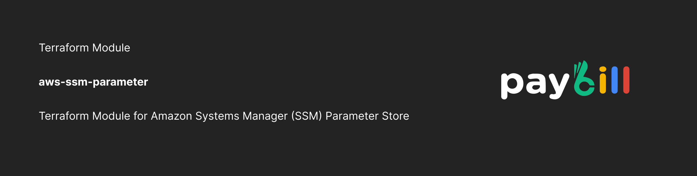

  <a href="https://paybill.dev" target="_blank">
    <picture>
      
    </picture>
  </a>

# Terraform Module: Security Group  

## Overview

AWS Systems Manager (SSM) Parameter Store for your cloud project  

<!-- BEGIN_TF_DOCS -->
## Requirements

No requirements.

## Providers

| Name | Version |
|------|---------|
|  [aws](#provider\_aws) | n/a |

## Modules

No modules.

## Resources

| Name | Type |
|------|------|
| [aws_ssm_parameter.default](https://registry.terraform.io/providers/hashicorp/aws/latest/docs/resources/ssm_parameter) | resource |

## Inputs

| Name | Description | Type | Default | Required |
|------|-------------|------|---------|:--------:|
|  [parameter\_defaults](#input\_parameter\_defaults) | Parameter write default settings | `map(any)` | <pre>{   "description": null,   "overwrite": "false",   "tier": "Standard",   "type": "SecureString" }</pre> | no |
|  [ssm\_parameters](#input\_ssm\_parameters) | List of maps with the parameter values to write to SSM Parameter Store | `list(map(string))` | `[]` | no |
|  [tags](#input\_tags) | Tags to assign the resources. | `map(string)` | n/a | yes |

## Outputs

No outputs.
<!-- END_TF_DOCS -->